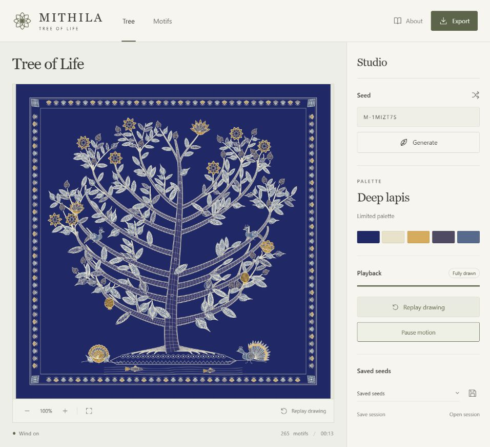
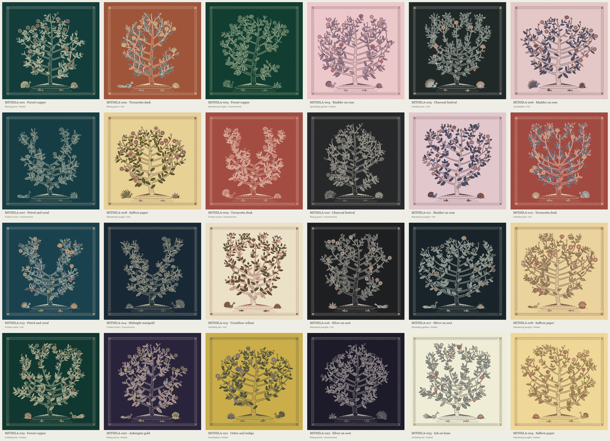

# Mithila — Tree of Life

A procedural drawing application inspired by Madhubani painting. Enter a seed to generate a tree with its own branching structure, palette, motifs and border. The drawing develops over 10–15 seconds, then moves gently in the wind.



The artwork is constructed from vector paths in the browser.

## Run locally

You need Node.js and a modern browser. No installation or build step is required.

```sh
node server.mjs
```

Open [127.0.0.1:4173](http://127.0.0.1:4173/). Run the command from this folder, alongside `package.json`. To use a different port, set `MITHILA_PREVIEW_PORT` before starting the server.

The preview server listens on this computer only. Any static web server can also serve the contents of `dist/`. Opening `index.html` directly from the filesystem will not load its JavaScript modules correctly.

## Use

- Enter a seed and select **Generate**, or use the shuffle button for a new seed.
- **Replay drawing** starts the same tree again. **Draw ahead** advances an unfinished drawing. Drawing and wind can be paused separately.
- Scroll or pinch to zoom; drag to pan. **Motifs** shows enlarged forms from the current seed.
- Save named seeds in the browser, or download a session file to retain drawing progress and motion time.
- Export the current drawing as SVG or PNG, with an optional transparent background. PNG sizes are 2,000, 4,000 or 6,000 pixels square. Zoom and pan do not crop exports.

Keyboard controls: Space pauses/resumes playback, +/− zooms, and 0 fits the artwork. Arrow keys pan when the artwork is focused. On small screens, **Studio** opens the controls.

The same seed reproduces its artwork within generator version **4**, and its poses at the same simulation time within motion version **2**. This release is application version **4.1.1**. Composition and illustration rules are unchanged; wind responses have been strengthened to read at the fitted viewing size. Earlier session files open with the current motion rules. Later generator or motion versions may change the corresponding result.

## What varies

Six composition recipes combine lateral, bifurcating, fan and tiered branching. Eight motif types include parameterized lotus, peacock and fish families. Eighteen palette families cover light and dark backgrounds, monochrome, limited color and multicolor paintings. Twelve border families vary their repeat pattern, spacing, pigments and corners.



## Development

There are no runtime package dependencies. `dist/` contains the editable application source; it is not generated build output.

```sh
node --test
```

Validation has used Node.js 24.19.0 and the local Chromium-based browser. A conservative rendering policy for a 4 GB Raspberry Pi 4 at 1080p is available at `/?performance=pi4`. It retains the artwork and full vector exports while limiting screen cost. Actual Pi hardware, other browser engines and physical phones still need device testing.

After drawing, the paper, border and ground remain vectors while the canopy uses a moving canvas layer. Wind builds smoothly over 2.5 seconds, with restrained bough movement and more responsive leaves and twigs. Close zoom and exports retain full vector detail. The Pi mode targets 20 updates per second; dense paintings can still stutter while their display caches finish preparing. See the recorded results before treating this as a Pi performance guarantee.

- [Generation and module guide](docs/GENERATION.md)
- [Development, hosting and troubleshooting](docs/DEVELOPMENT.md)
- [Validation and performance](docs/VALIDATION.md)
- [Raspberry Pi 4 setup and device benchmark](docs/RASPBERRY_PI.md)
- [References and credits](docs/REFERENCES.md)
- [Licensing guide and current status](docs/LICENSING.md)
- [Release notes](CHANGELOG.md)

All generation, saved seeds and exports stay in the browser. The app has no analytics, account system, remote fonts or API calls. Reference links open external websites only when followed.

## Credits

- **Mithila's artists and painting communities** for the Madhubani visual tradition; **Ranjan Paswan's *Tree of life with Krishna* (2015)** for a specific composition reference.
- **Lingdong Huang's [{Shan, Shui}*](https://github.com/LingDong-/shan-shui-inf)** for procedural-art and modular drawing inspiration.
- **Shucun Sun, Karl J. Niklas, Fei Fang, Shuang Xiang, Xinwei Wu and Xiaocheng Yang (2010)** for the branching diagram in [Figure 1 of their study](https://doi.org/10.1086/653544).
- **Tommy Ettinger and bryc** for Mulberry32; **Glenn Fowler, Landon Curt Noll and Kiem-Phong Vo** for FNV hashing.

[Full references, research authors and how each source was used](docs/REFERENCES.md) · [Third-party code notices](THIRD_PARTY_NOTICES.md)

## License

Licensed under the [MIT License](LICENSE). Copyright (c) 2026 starphazed.

The project license covers the original application source and associated documentation. Preserve the [third-party notices](THIRD_PARTY_NOTICES.md) and existing credits. Referenced paintings, research figures and the Mithila painting tradition are not relicensed by this project. See [licensing and distribution](docs/LICENSING.md).
